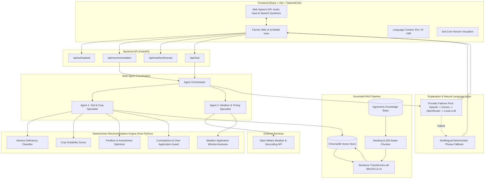

# AgriMind — System Architecture & Design Specification

AgriMind is an agentic, evidence-grounded decision support system for agriculture. It adheres to a strict architectural rule: **"The deterministic engine calculates; the LLM explains."** This prevents hallucinated dosages, incorrect nutrient thresholds, or phantom agricultural advice.

---

## 1. High-Level Architecture Diagram



---

## 2. Repository & Folder Structure

```
agrimind/
├── .env.example                     # Root environment variable template
├── .gitignore                       # Git exclusion rules
├── AgriMind_Project_Description.pdf # Original engineering and design specification
├── docker-compose.yml               # Multi-container orchestration (backend + frontend)
├── setup_windows.ps1                # Automated setup & verification script for Windows
├── verify_setup.py                  # Standalone verification script for soil parsing
├── sample_data/                     # Sample soil reports for testing
│   └── Soil_Test_Report_Demo_Farm.pdf
├── backend/                         # Python 3.12 + FastAPI backend
│   ├── .env.example                 # Backend environment variable template (sanitized)
│   ├── Dockerfile                   # Backend container definition
│   ├── pytest.ini                   # Pytest configuration
│   ├── requirements.txt             # Python dependency manifest
│   ├── app/
│   │   ├── main.py                  # FastAPI application entrypoint & middleware
│   │   ├── agents/                  # Multi-agent coordination layer
│   │   │   ├── orchestrator.py      # Combines Agent 1 & Agent 2, RAG, and LLM
│   │   │   ├── soil_agent.py        # Agent 1: Soil, crop scoring & fertilizer rules
│   │   │   └── weather_agent.py     # Agent 2: Forecast retrieval & timing analysis
│   │   ├── api/                     # REST API endpoints
│   │   │   ├── chat.py              # Follow-up interactive chat
│   │   │   ├── recommendation.py    # Soil analysis & recommendation endpoint
│   │   │   ├── soil.py              # PDF upload & extraction endpoint
│   │   │   └── weather.py           # Geocoding & live forecast endpoint
│   │   ├── engine/                  # Deterministic agricultural rules (NO LLM)
│   │   │   ├── application_window.py# Safe application timing logic
│   │   │   ├── crop_scorer.py       # Arithmetic crop suitability scorer
│   │   │   └── fertilizer_optimizer.py # Indian Soil Health Card deficiency & dosage logic
│   │   ├── models/                  # Pydantic data schemas
│   │   │   ├── crop.py              # Crop requirements & suitability models
│   │   │   ├── recommendation.py    # Recommendation response & evidence schemas
│   │   │   └── soil.py              # Structured SoilReport schema
│   │   ├── rag/                     # Retrieval-Augmented Generation pipeline
│   │   │   ├── chunker.py           # Markdown heading & Q/A aware chunker
│   │   │   ├── embedding_service.py # Sentence Transformers embedding interface
│   │   │   ├── index_knowledge.py   # Vector database indexing CLI script
│   │   │   ├── knowledge_loader.py  # Markdown and JSON file loader
│   │   │   ├── retriever.py         # Semantic search and evidence builder
│   │   │   └── vector_store.py      # ChromaDB persistent collection wrapper
│   │   └── services/                # Integration & helper services
│   │       ├── crop_service.py      # Crop requirements dataset loader
│   │       ├── fertilizer_service.py# Fertilizer options dataset loader
│   │       ├── i18n.py              # Multilingual phrase templates (EN/HI/MR)
│   │       ├── llm_service.py       # Multi-provider failover explanation generator
│   │       ├── pdf_service.py       # PyMuPDF text extraction (no OCR)
│   │       ├── soil_parser.py       # Regex soil report parser
│   │       └── weather_service.py   # Open-Meteo REST client
│   ├── data/knowledge/              # Agronomic knowledge base (RAG sources)
│   │   ├── crops/                   # Crop requirements JSON
│   │   ├── fertilizer/              # Fertilizer products & application options
│   │   ├── organic/                 # Organic practices & soil amendments
│   │   ├── pesticides/              # Safe IPM notes (reference only, no dosages)
│   │   └── soil/                    # Soil Health Card guide & CGIAR Framework
│   ├── tests/                       # Automated pytest test suites
│   ├── uploads/                     # Uploaded PDF temporary storage
│   └── vector_db/                   # ChromaDB persistent vector database
└── frontend/                        # React 18 + Vite + TailwindCSS frontend
    ├── Dockerfile                   # Frontend container definition
    ├── index.html                   # HTML entrypoint
    ├── package.json                 # Node dependencies and scripts
    ├── tailwind.config.js           # Agricultural theme tokens & palette
    ├── vite.config.js               # Vite build configuration
    └── src/
        ├── main.jsx                 # React root renderer
        ├── App.jsx                  # Main application layout & state coordinator
        ├── api.js                   # Backend API client
        ├── index.css                # Global styles, fonts, and custom utilities
        ├── components/
        │   ├── ChatBox.jsx          # Follow-up Q&A chat component
        │   ├── InputPanel.jsx       # File upload, location & crop selector
        │   ├── LanguageSwitcher.jsx # English/Hindi/Marathi language toggle
        │   ├── RecommendationPanel.jsx # Crop suitability & fertilizer cards
        │   ├── SoilCore.jsx         # Stratified soil horizon visualization
        │   ├── WeatherPanel.jsx     # Forecast & application window status
        │   └── WhyPanel.jsx         # Grounded evidence & confidence meter
        └── i18n/
            ├── LanguageContext.jsx  # React context for locale management
            └── translations.js      # UI translations for EN, HI, and MR
```

---

## 3. Core Data Flow

### A. Soil Report Ingestion Flow
1. Farmer uploads a PDF file via `InputPanel.jsx`.
2. Frontend sends `multipart/form-data` to `POST /api/soil/upload`.
3. `pdf_service.py` extracts raw text from PDF pages using PyMuPDF.
4. `soil_parser.py` scans text with tolerant regex patterns for core parameters (N, P, K, pH, OC, EC) and micronutrients (Zn, Fe, S, B).
5. Structured `SoilReport` is returned to the frontend and immediately visualized in `SoilCore.jsx`.

### B. Recommendation Orchestration Flow
1. Farmer enters farm location, optionally selects a crop and organic preference, and clicks "Analyze".
2. Frontend sends `RecommendationRequest` to `POST /api/recommendation`.
3. `orchestrator.py` triggers `SoilAgent` and `WeatherAgent`:
   - **`SoilAgent` (Agent 1):**
     - Classifies deficiencies (`detect_deficiencies`) against official Soil Health Card thresholds.
     - Computes crop suitability scores (0-100) across all supported crops.
     - Selects targeted fertilizers/amendments for LOW nutrients only.
     - Checks for contradictions between farmer requests and high nutrient levels.
     - Retrieves grounded evidence chunks from ChromaDB.
   - **`WeatherAgent` (Agent 2):**
     - Geocodes location using Open-Meteo.
     - Fetches 7-day weather forecast (precipitation, precipitation probability, wind speed, temperature).
     - Assesses application window ("GO" vs "WAIT") based on runoff risk rules.
4. `orchestrator.py` combines results into `WhyThisRecommendation`, calculates overall confidence, and calls `llm_service.py`.
5. `llm_service.py` crafts the natural-language explanation using OpenAI -> Gemini -> OpenRouter -> Local LLM -> Deterministic template fallback in the requested language (`en`, `hi`, `mr`).
6. Complete `RecommendationResponse` is returned to the frontend.

---

## 4. Architectural Decisions & Guardrails

1. **Deterministic Calculations Over Generative Hallucinations:**  
   Nutrient status, crop scores, and application timing decisions are strictly computed by deterministic Python code in `app/engine/`. The LLM's only job is natural language synthesis and explanation.
2. **Multi-Tier LLM Failover & Offline Capability:**  
   The application does not break if LLM quotas are exhausted or no API key is supplied. The deterministic template engine ensures 100% operational functionality at zero cost.
3. **Evidence Grounding (RAG):**  
   Every recommendation is paired with source evidence from curated agricultural references (e.g., CGIAR Soil Health Framework, Indian Soil Health Card guide).
4. **Pesticide Safety Boundary:**  
   Chemical pesticide recommendations are intentionally withheld from automated generation to avoid hazardous or non-approved pesticide usage.
5. **Multilingual by Design:**  
   Full localization architecture supports English, Hindi (हिंदी), and Marathi (मराठी) across UI labels, status messages, and natural language explanations.
